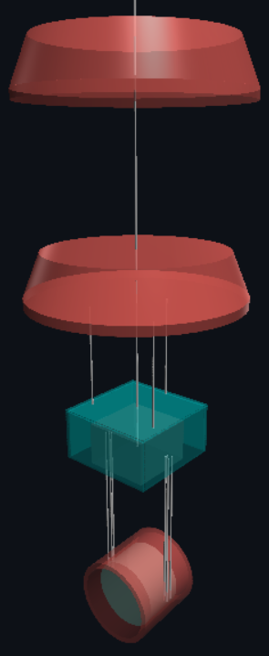

# Gwsus

[](https://naibafomsare.github.io/gwsus/)


[](https://naibafomsare.github.io/gwsus/)
[](https://naibafomsare.github.io/gwsus/)




### Numerical rigid-body simulation of the mirror suspensions of the gravitational-wave detector KAGRA [🔗](https://gwcenter.icrr.u-tokyo.ac.jp/en/)


Predicting the behaviour of mirror suspensions is a mandatory task for the construction and operation
of gravitational-wave detectors. Before construction, it is necessary to ensure that the 
vibration isolation systems and payloads meet the requirements. And after construction, it is necessary to identify stray resonant motion during commissioning and astronomical observations. Gwsus aims to provide these capabilities and more.

One of the motivations for writing it is to replace the software that is currently used in KAGRA for the same tasks. Despite the fact that such a package produces scientifically sound predictions, it has bugs and has not been maintained since 2015. It also has the disadvantage of requiring a license to run on Mathematica.
Gwsus is written in Python, which is a more accesible language, and is easy to maintain and use.

<br clear="right"/>

## Current and future features

- Works in the frequency domain.
- Calculates resonance frequencies, mode shapes, and creates interactive
  3D animations of the modes for ease of examination.
- Computes transfer functions.
- Provides templates for the components of the signal
  recycling suspensions of KAGRA.
- In future releases:
    - It will calculate displacement thermal noise and
    - Provide templates for the components of Type-Bp and Type-A suspensions.

## [🔗](TODO.md) Project status

This software is still in an experimental stage and in constant development.
There are features that need to be added or improved before it is ready
for scientific work. The highlights of the pending tasks are:

- Implement inverted pendulums.
- Implement the wire bending potential.
- Validate results by comparison with independent calculations.

## [🔗](https://naibafomsare.github.io/gwsus/auto_examples/) Tutorial

The current tutorial describes how to implement one of KAGRA's SR suspensions.
It covers first the specification of the components and their assembly into a suspension.
Then it illustrates how to calculate resonance frequencies, mode shapes and how to show
them in interactive 3D animations.


## [🔗](https://naibafomsare.github.io/gwsus/) Documentation

It covers installation instructions, tutorials, theoretical background, application programing interface (API) and bibliography.


## Requirements

- Python 3.10 or later
- Numpy
- Mpmath
- Sympy
- Symengine
- VPython
- Bigtree
- Matplotlib
- Tabulate
- Termcolor

## Installation

Clone the repository:

```bash
git clone https://github.com/[USERNAME]/Gwsus.git
cd Gwsus
```

Create and activate a virtual environment:

```bash
python -m venv .venv
source .venv/bin/activate
```

On Windows, activate the environment with:

```powershell
.venv\Scripts\activate
```

Install the project and its dependencies:

```bash
python -m pip install -e .
```

This command assumes that the repository contains a correctly configured `pyproject.toml`.
    

## Acknowledgments

As SUMCOM before, Gwsus is based on Mark Barton's software *Pendulum Toolkit*,
which is written in Mathematica and was developed specifically to analyze LIGO's suspensions. Whereas
Gwsus aims to be accesible, easy to maintain and use, and tailored for KAGRA-style suspensions,
Pendulum Toolkit remains an authoritative reference.

